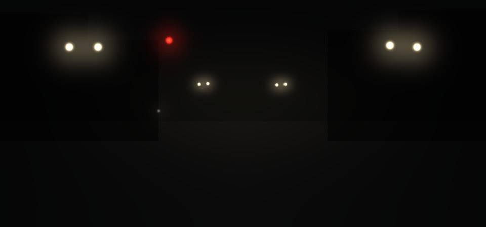
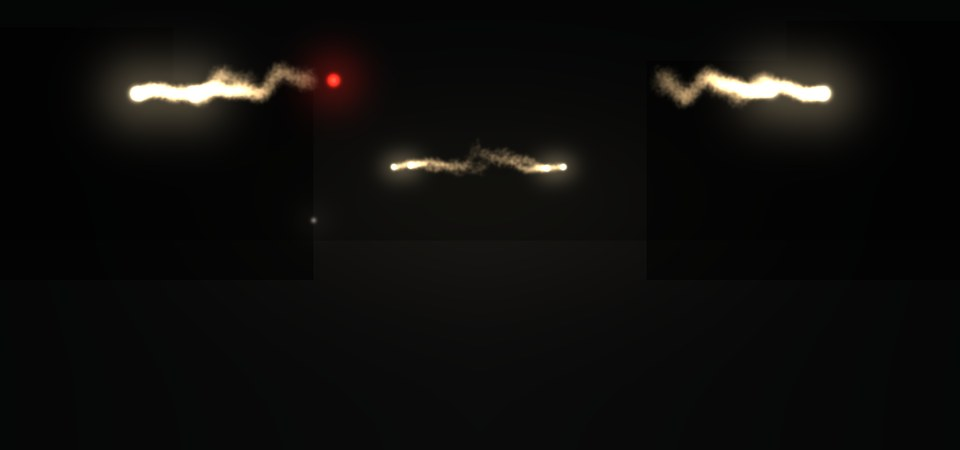
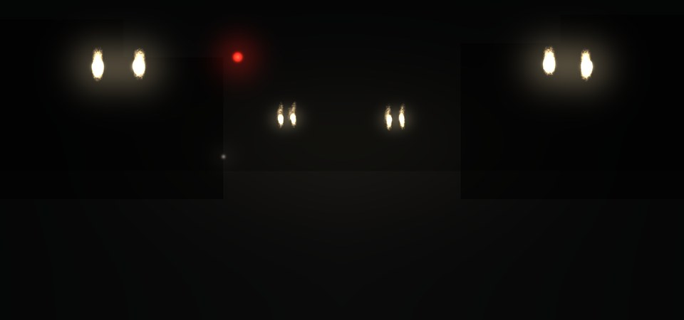

# Light Trails for DaVinci Resolve

Wavy, smoky trails from the hottest white lights. Every version is kept here, with a one-click Windows installer. The full page with comparison images is `index.html` in this folder (served by GitHub Pages once Pages is on).

## Install

Download **[Install-LightTrails.bat](https://github.com/MohamedMabrook/Website/raw/claude/pensive-ride-egnx10/light-trails/Install-LightTrails.bat)** and double-click it. It lists every version and what's installed now. Press Enter for the recommended one, or type a number. It asks for administrator rights for OpenFX plugins, waits for Resolve to close, and backs up whatever it replaces to `%LOCALAPPDATA%\LightTrails\backup`.

PowerShell, same menu:

```powershell
irm https://raw.githubusercontent.com/MohamedMabrook/Website/claude/pensive-ride-egnx10/light-trails/install.ps1 | iex
```

A specific version:

```powershell
& ([scriptblock]::Create((irm https://raw.githubusercontent.com/MohamedMabrook/Website/claude/pensive-ride-egnx10/light-trails/install.ps1))) -Version 2.1
```

## Versions

| Version | Kind | Still lamps trail | Frames read per tweak | Notes |
|---|---|---|---|---|
| **[2.1](versions/2.1/)** (recommended) | OpenFX, Color page, CUDA | Yes | 1 | Inward, Outward, Up or Angle streaks; likely Decay-crash fix; render log |
| [2.0](versions/2.0/) | OpenFX, Color page, CUDA | No | 1 cached, up to 13 after a reset | Quality menu, depth, whites-only key; suspected crash |
| [1.1](versions/1.1/) | OpenFX, Color page, CUDA + CPU | No | 13 | Very slow; untick Use GPU for 1.0 behavior |
| [0.1](versions/0.1/) | Fuse, Fusion page | Only with Drift | 13 | First version; zip also holds the original DCTL |

1.0 (CPU only) isn't archived: its build was overwritten when 1.1 was compiled. 1.1 with Use GPU off runs the same CPU path.

| Source (lamps don't move) | 2.1 Inward | 1.1 and 2.0 (Follow Motion) |
|---|---|---|
|  |  |  |

## Files

- `versions.json`: the version list the installer reads.
- `install.ps1`, `Install-LightTrails.bat`: the installer.
- `versions/<n>/`: each version's package, including full source.
- `img/`: comparison renders of a synthetic test scene.
